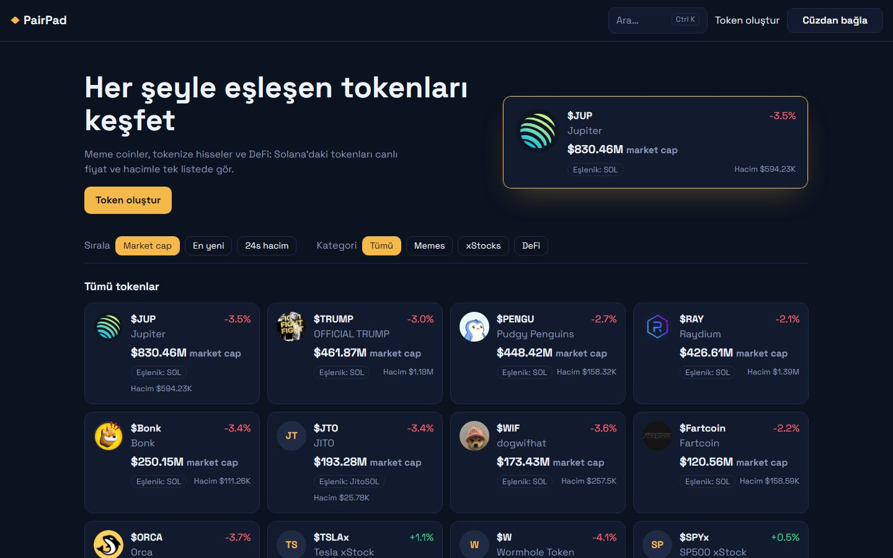
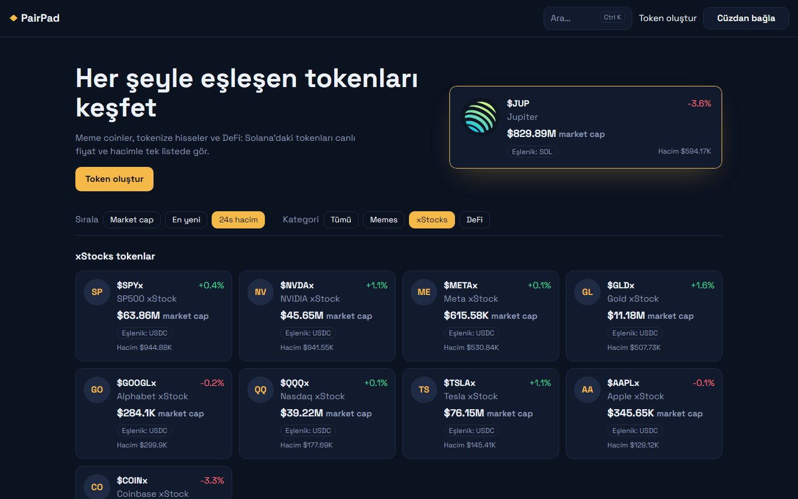
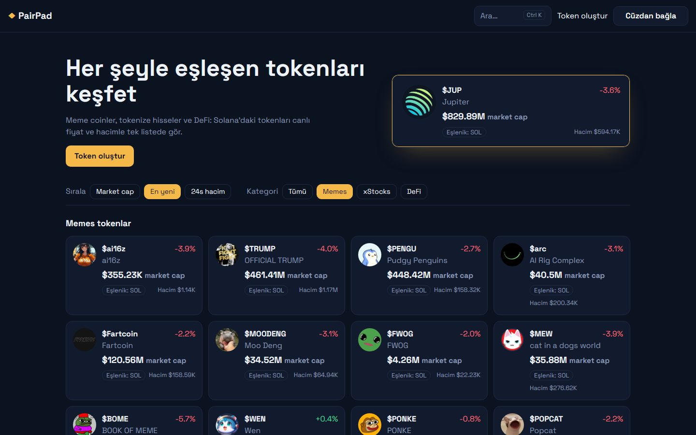
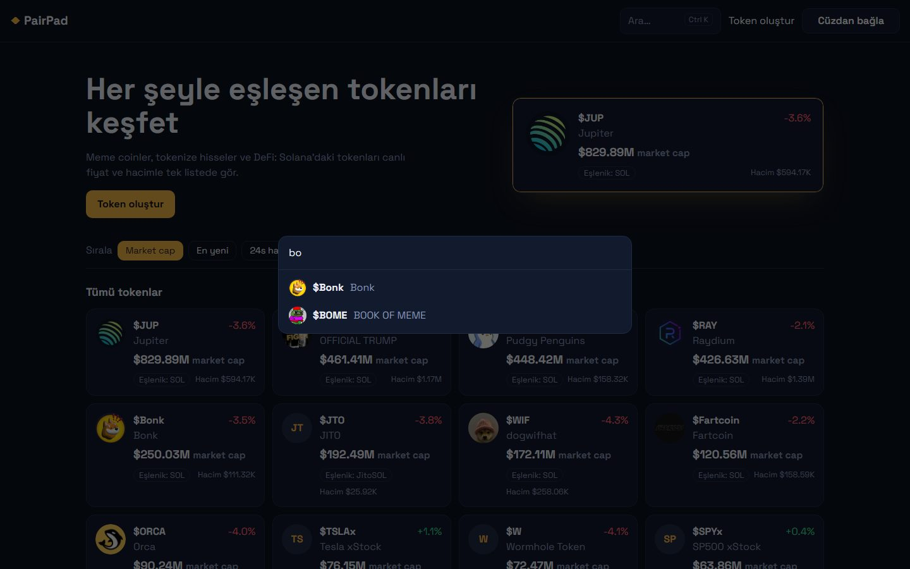
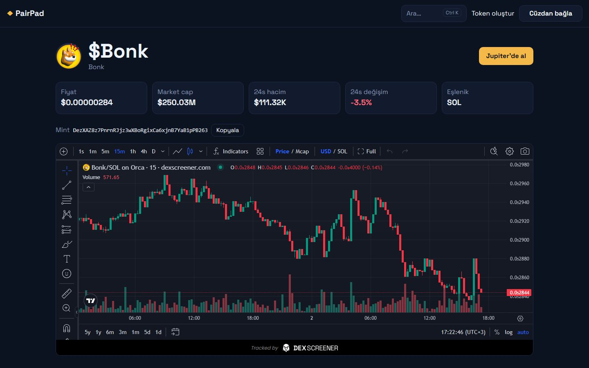
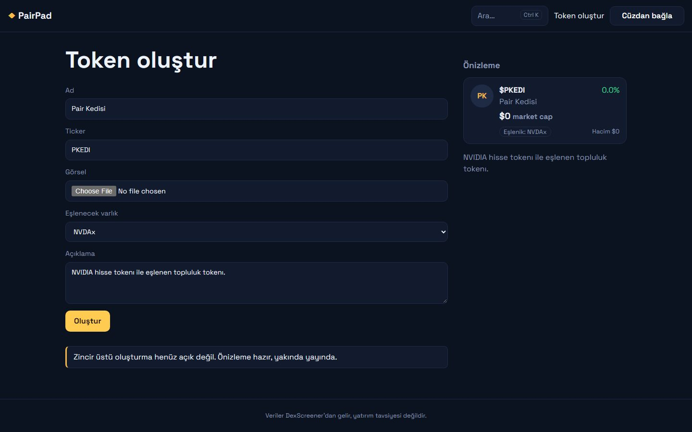
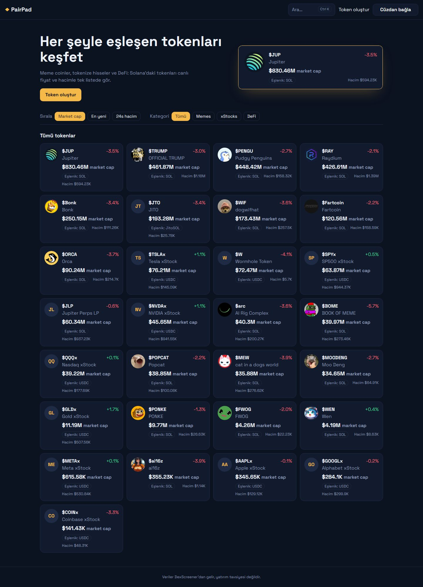
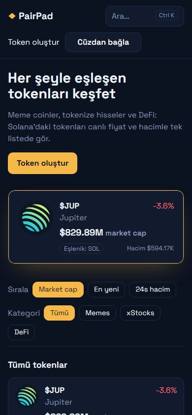
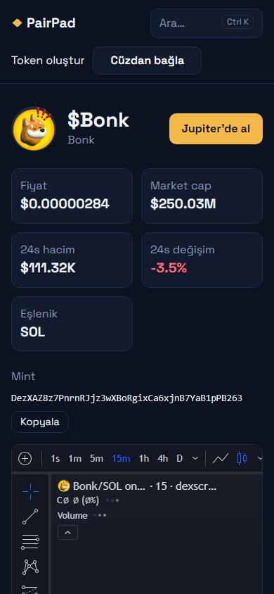

<h1 align="center">PairPad</h1>

<p align="center">
  Solana tokenları için kurulmaya hazır keşif sitesi.<br>
  Canlı fiyat, market cap ve hacim; kategori filtreleri, hızlı arama, token sayfaları ve cüzdan bağlama.
</p>

<p align="center">
  
  
  
  
  
</p>

<p align="center">
  
</p>

---

## Kimin için?

Kendi Solana token listesini yayınlamak isteyen **topluluklar, launchpad girişimleri ve kripto içerik siteleri** için hazırlandı. Ziyaretçiler tokenları kategoriye ve hacme göre sıralar, adıyla ya da mint adresiyle arar, token sayfasında canlı grafiği görür ve tek tıkla Jupiter'de işlem açar.

## Öne çıkanlar

- **Canlı veri, API anahtarı yok:** Fiyat, market cap, 24 saatlik hacim ve değişim DexScreener'ın açık API'sinden gelir ve 30 saniyede bir yenilenir. Ücretli servis gerekmez.
- **Listeyi siz belirlersiniz:** Hangi tokenların listeleneceği ve hangi kategoride görüneceği tek bir dosyadan yönetilir. Mint adresini eklemeniz yeterli.
- **Eşlenik bilgisi:** Her kartta tokenın en likit havuzunda neyle eşlendiği (SOL, USDC, JitoSOL…) gösterilir.
- **Ctrl K ile arama:** Ad, ticker veya mint adresiyle anında arama.
- **Cüzdan bağlama:** Phantom, Solflare, Backpack ve Wallet Standard destekleyen diğer cüzdanlar otomatik tanınır. Bağlanınca SOL bakiyesi görünür.
- **Hızlı ve SEO dostu:** Liste ve token sayfaları sunucuda oluşturulur. Filtreler URL'de tutulur, böylece her filtre paylaşılabilir bir bağlantıdır.

## Özellikler

| | |
|---|---|
| **Ana sayfa** | En yüksek market cap'li token öne çıkan kartta gösterilir. Altında tüm tokenlar ızgara halinde listelenir |
| **Sıralama** | Market cap, en yeni havuz, 24 saatlik hacim |
| **Kategoriler** | Memes, xStocks (tokenize hisseler), DeFi. Kategoriler serbestçe eklenip değiştirilebilir |
| **Token sayfası** | Fiyat, market cap, hacim, 24s değişim, eşlenik, kopyalanabilir mint adresi, canlı DexScreener grafiği, "Jupiter'de al" butonu |
| **Token oluştur** | Ad, ticker, görsel, eşlenecek varlık ve açıklama girilir; kart önizlemesi yazdıkça güncellenir |
| **Mobil** | Tüm sayfalar telefonda yatay kaydırma olmadan çalışır |

## Ekran görüntüleri

| | |
|---|---|
| <br>**xStocks, hacme göre sıralı** | <br>**Memes, en yeniler** |
| <br>**Ctrl K ile arama** | <br>**Token sayfası ve canlı grafik** |
| <br>**Token oluşturma ve önizleme** | <br>**Tüm token listesi** |

<p align="center">
  
  &nbsp;
  
</p>

## Teknik altyapı

- **Next.js 16** (App Router, sunucu bileşenleri), React 19, TypeScript
- **Veri:** DexScreener açık API'si, 30 saniyelik önbellek. API'ye ulaşılamazsa site çökmez, bilgilendirme mesajı gösterir
- **Cüzdan:** Solana Wallet Adapter + Wallet Standard
- **Tasarım:** Tek CSS dosyası, harici UI kütüphanesi yok. Renkler birkaç değişkenden değiştirilir
- **Testler:** Vitest ile veri dönüştürme testleri

### Sunucu gereksinimleri

Node.js 20 veya üzeri. Vercel, Netlify ya da Node çalıştırabilen herhangi bir VPS yeterlidir. Veritabanı gerekmez.

## Pakette neler var?

- Tam kaynak kod
- Hazır token listesi (29 token: memes, xStocks, DeFi)
- Kurulum belgesi
- Otomatik testler

## Kurulum (özet)

```bash
npm install
npm run build
npm start
```

İsteğe bağlı olarak `.env` dosyasında `NEXT_PUBLIC_RPC_URL` ile kendi Solana RPC adresinizi (Helius, QuickNode vb.) tanımlayabilirsiniz. Ayrıntılı kurulum belgesi pakette yer alır.

## Sık sorulan sorular

**Gerçekten zincir üstünde token oluşturuyor mu?**
Hayır. "Token oluştur" sayfası form ve önizleme olarak gelir. Zincir üstü oluşturma (bonding curve, havuz açma) bu pakete dahil değildir.

**Listeye istediğim tokenı ekleyebilir miyim?**
Evet. Solana üzerinde DexScreener'da işlem gören her token mint adresiyle eklenebilir.

**Ziyaretçiler kendi tokenlarını listeleyebilir mi?**
Hayır. Liste site sahibi tarafından yönetilir. Kullanıcı hesabı ve veritabanı yoktur.

**Tasarımı ve markayı değiştirebilir miyim?**
Evet. Ad, logo ve renkler birkaç dosyadan değiştirilir.

**Ücretli bir servise bağımlı mı?**
Hayır. Veri ve grafik ücretsiz kaynaklardan gelir.

## Lisans ve satın alma

Bu depo yalnızca ürün tanıtımı içindir ve kaynak kod içermez. PairPad ticari lisansla sunulur; tüm hakları saklıdır.

Satın alma, fiyat bilgisi veya canlı demo talebi için **[bu depoda bir talep açın](https://github.com/redsteelhat/pairpad-scripti/issues/new?title=Sat%C4%B1n%20alma%20%2F%20demo%20talebi)**.

---

<sub>Ekran görüntülerindeki token adları ve logoları sahiplerine aittir. Piyasa verileri ve grafik DexScreener'dan alınmıştır. Bu site yatırım tavsiyesi vermez.</sub>
